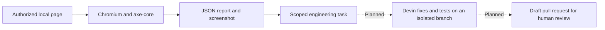

# AccessLoop

AccessLoop turns accessibility violations from a local browser scan into engineering tasks a developer or coding agent can reproduce, fix, and test.

Automated checkers can flag a missing label or accessible name. Developers still need to locate the affected control, understand the browser evidence, and verify that a fix preserves the interaction. AccessLoop packages the axe finding, affected DOM, screenshot, reproduction steps, and verification criteria into a handoff.

## What works today

- A local demo pairs an unlabeled email field and unnamed submit button with a corrected version of the same form.
- The TypeScript CLI runs axe-core in headless Chromium and writes a JSON report and full-page PNG to a new directory for each scan.
- The task CLI converts one reported rule and element into a JSON task with an operator-provided file allowlist, acceptance criteria, regression tests, and a human review gate.
- Playwright verifies both scan outcomes, keyboard submission, report contents, the task handoff, and failure handling. GitHub Actions runs the suite and uploads reports, screenshots, and failure traces.

The [architecture notes](docs/ARCHITECTURE.md) describe the report and task boundaries. The [Devin agent prompt](docs/DEVIN_AGENT_PROMPT.md) defines the future fix and review contract.



## Run locally

Use Node.js 24 LTS and npm. If you use nvm, run `nvm install` and `nvm use` from the checkout.

| Command | What it does |
| --- | --- |
| `npm ci` | Install packages from the lockfile. |
| `npm run browser:install` | Install the Playwright Chromium build. On Linux, `npx playwright install --with-deps chromium` also installs required system packages. |
| `npm start` | Start the demo on `127.0.0.1:4173`. Leave this running in its own terminal for the scan commands. |
| `npm run scan:before` | Scan `/before.html`. Exit 1 is expected because both intentional violations are present. |
| `npm run scan:after` | Scan `/after.html`. Exit 0 is expected. |
| `npm test` | Start a separate local demo on port 4174 and run the Chromium suite. |
| `npm run typecheck` | Validate TypeScript with strict checking. |
| `npm run task:generate -- --help` | Show the task generation options. |

To scan a specific authorized local page, run:

```sh
npm run scan -- --url http://127.0.0.1:4173/after.html --out reports/local/custom
```

The CLI prints the generated `scan.json` path. Open `page.png` in that report's directory for the visual evidence. Scan exit codes are **0** for zero violations, **1** for detected violations, and **2** for an input or operational error. Incomplete axe checks are counted separately for manual follow-up.

Generate a task from the included real scan, or substitute the report path from your own run:

```sh
npm run task:generate -- --report reports/sample/before/scan.json --rule label \
  --allow-file public/before.html --allow-file tests/accessloop.spec.ts \
  --out reports/local/label-task.json
```

`--element` selects the zero-based index within that violation's `elements` array and defaults to 0. Pass each approved file with a separate `--allow-file`. To get JSON on standard output, omit `--out` and run npm with `--silent`. The included task illustrates the handoff for the intentionally broken control. The baseline fixture stays broken so the suite can exercise detection.

## Reproduced results

The included evidence came from the local demo in Chromium 159.0.8154.6 with axe-core 4.14.1. The before page returned two critical violations. The after page returned zero violations. Both scans recorded zero incomplete rules.

| Page | Browser result | Evidence |
| --- | --- | --- |
| Before | `button-name` on `#submit` and `label` on `#email`. Exit 1. | [Report](reports/sample/before/scan.json) · [Screenshot](reports/sample/before/page.png) |
| After | Zero violations in the same axe scan. Exit 0. | [Report](reports/sample/after/scan.json) · [Screenshot](reports/sample/after/page.png) |

The corrected page uses a native `label` linked to the email input and a native button with visible `Submit` text. The regression test checks the names exposed to Playwright, Tab order, and successful submission with Enter. The [sample task](reports/sample/label-task.json) preserves the selected finding's actual failure summary and target. Automated checks cover a subset of accessibility requirements. Assistive technology and manual review remain part of judging an application. [Playwright accessibility testing](https://playwright.dev/docs/accessibility-testing)

## Security and review

Run the scanner only against an application you are authorized to test. It accepts literal loopback addresses (`127.0.0.1` and `[::1]`) without URL credentials. Each scan gets a fresh browser context and routes web requests to the selected origin. HTTP redirects, WebSockets, and service workers are blocked. Use a trusted local test instance with test data because HTML and screenshots can contain page content. Keep newly generated artifacts in the ignored `reports/local/` directory when they include private data.

CI has read-only repository contents access, leaves checkout credentials unpersisted, and uses no project secrets. The task allowlist is supplied by the operator and must be enforced by any future integration before opening a draft pull request. A human reviews the patch and evidence and controls merge and deployment.

## Project status

**Implemented** — local scanning, before-and-after demo, browser evidence, task generation, regression tests, and CI configuration.

**Planned** — send an approved task to a Devin Bot, apply a fix in an isolated branch, rerun checks on that branch, and prepare a draft pull request for human review. The current CLI generates the handoff JSON locally. [Development roadmap](docs/ROADMAP.md)

Released under the [MIT License](LICENSE).
